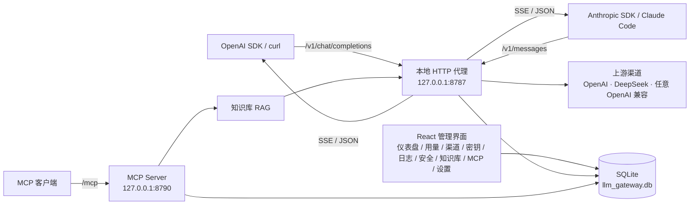
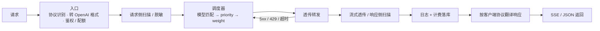

<div align="center">


# LLM API Gateway

**本地桌面 LLM API 网关 · 一个端点接入所有上游**

把 OpenAI / Anthropic / Responses 三种客户端协议收敛到 `http://127.0.0.1:8787`，
在桌面应用里管理渠道、密钥、用量计费、安全审计，并内置本地知识库（RAG）与 MCP 服务。

[](https://tauri.app)
[](https://react.dev)
[](https://www.rust-lang.org)
[](https://github.com/launchbadge/sqlx)
[](#系统要求)

仓库：<https://github.com/fengbaohuo1/jnf-llm-api-gateway>

</div>

---

## 为什么需要它

同时使用多个模型服务（OpenAI、DeepSeek、各家中转、本地推理）时，通常会遇到这些麻烦：

- 每套 SDK / 客户端都要单独配 `base_url` 和 API Key，换模型就要改代码；
- 每个上游各有各的账单，想知道「这个月到底花在哪」得自己拼表格；
- 担心把 API Key、内部地址、个人信息顺手发给了模型；
- 出问题想复盘时，找不到一个能看完整请求 / 响应的地方。

LLM API Gateway 把这些收进一个桌面应用：客户端只指向**一个本地端点**，渠道切换、计费明细、安全审计、请求日志全部在本地完成。除转发给你自己配置的上游之外，数据不离开本机。

## 功能特性

### 一个端点，三种协议

| 方法 | 路径 | 说明 |
| --- | --- | --- |
| `POST` | `/v1/chat/completions` | OpenAI Chat Completions（非流式 / SSE 流式） |
| `POST` | `/v1/messages` | Anthropic Messages API，入口/出口自动翻译 |
| `POST` | `/v1/responses` | OpenAI Responses API，入口/出口自动翻译 |
| `GET` | `/v1/models` | 列出活跃渠道提供的模型 |
| `GET` | `/health` | 健康检查（免鉴权） |
| `POST` | `/mcp` | MCP 服务端点（独立端口，见「MCP 服务」） |

- **内部只认一种格式**：入口把 Anthropic / Responses 请求转成 OpenAI 格式，出口再翻译回客户端协议（含 SSE 事件流、usage 明细、错误结构），内部管线（鉴权 → 扫描 → 调度 → 转发 → 脱敏 → 记账）没有协议分支。
- **OpenAI 原生请求透传**：只改 URL 和 `Authorization`，保留 `tools`、结构化输出等扩展字段，不丢字段。
- 翻译层已对齐常用字段：system、content blocks（text / image / tool_use / tool_result）、tools schema、stop sequences、max tokens、usage 明细；thinking / reasoning 字段按协议兼容处理。
- 每个请求的客户端协议（`openai` / `anthropic` / `responses`）会记入日志，便于区分调用来源。

### 渠道与调度

- **模型匹配 + 优先级 + 权重**：按请求的 `model` 过滤渠道，`priority` 降序，同一优先级内按 `weight` 无放回轮盘赌；渠道模型留空表示通配。
- **故障转移（默认关闭）**：遇到 5xx / 429 / 超时 / 网络错误时按顺序切换到下一个渠道，最多 `failover.max_attempts` 次；4xx 直接返回客户端，不重试。
- **没有故障就不做负载均衡**：正常请求固定走主渠道，只有失败才转移——这是刻意的设计选择，避免把「多通道」变成「随机抖动」。
- 渠道级配置：Base URL、API Key、模型、状态、优先级、权重，以及输入 / 输出 / 缓存命中 / 思考输出四项单价（界面按「元 / 百万 tokens」录入，内部按每 1k 存储，成本统一显示 `¥`）。
- **模型配置更省事**：按渠道类型预填常见 Base URL；点「获取模型」从上游 `GET /models` 拉取真实模型列表后点选（编辑已有渠道时复用已保存的 Key），DeepSeek 渠道打开编辑会自动通过接口加载模型，也可手填模型 ID；模型留空表示匹配任意模型。
- **渠道协议可选**：类型（OpenAI / DeepSeek / Custom…）决定品牌与默认值，协议（自动 / OpenAI 兼容 / DeepSeek / Anthropic / Gemini）决定实际适配器；自定义渠道可显式选协议，接入任意 OpenAI 兼容端点，或声明 DeepSeek 协议以启用思考模式兼容。
- **DeepSeek 思考模式兼容（渠道级开关，默认开启）**：DeepSeek 思考模型要求工具调用轮次的 assistant 消息回传 `reasoning_content`，而按 OpenAI 协议实现的客户端通常不回传。网关转发到 DeepSeek 协议渠道时自动补空占位（已有值不覆盖）；开关在渠道编辑弹窗内（仅 DeepSeek 协议渠道显示），可按渠道单独关闭。

### 上游渠道支持

| 渠道类型 | 状态 | 说明 |
| --- | --- | --- |
| OpenAI | ✅ | OpenAI 官方或兼容端点 |
| DeepSeek | ✅ | DeepSeek 官方；模型列表通过 `/models` 自动获取，含思考模式兼容 |
| 自定义（OpenAI 兼容） | ✅ | 中转服务、vLLM、LM Studio、Ollama 的 OpenAI 兼容层等；可显式选择协议 |
| Claude / Gemini | 🚧 | 类型保留；原生协议尚未实现，可把协议设为「OpenAI 兼容」接其兼容端点 |

> 注意：Anthropic / Responses 是**客户端协议**的支持，上游仍要求是 OpenAI 兼容端点。网关会做协议转换，所以 Claude Code、Anthropic SDK 这类客户端可以直接指向本网关。渠道的「协议」是另一层概念——它决定网关如何调用上游（当前可用 OpenAI 兼容与 DeepSeek），与客户端协议互不影响。

### 密钥与计费

- 密钥格式 `sk-llmapi-` + 32 位十六进制（128 bit 熵）。数据库**只存 SHA-256 hash 和前缀**，明文仅在创建 / 轮换时返回一次。
- 支持配额（token 数，`-1` 表示不限）、过期时间、编辑与轮换（旧钥立即失效，历史用量保留）。
- 记账统一入口：每次请求记录 prompt / completion / total tokens、缓存命中 token、思考 token、成本、延迟、状态；失败的尝试同样入库（`status = 0`）。
- **缓存与思考感知计费**：缓存命中 token 按缓存单价、思考输出 token 按思考单价计费，单价为 0 时回落到普通单价；未命中输入与普通输出按正常单价计。
- 用量页支持今日 / 本周 / 本月汇总、缓存命中率、按日堆叠柱状图（缓存命中 / 未命中 / 输出）；日期按北京时间（UTC+8）统计。
- 日志页可按渠道 / 模型 / 状态 / **安全风险**筛选、关键词搜索；详情分「收到的原始请求 / 实际转发体 / 响应 / 错误」四栏，包含流式响应的完整重建内容，并标注该请求命中的最高风险。
- **内容按安全等级存储**：`log.store_level` 可选「全存 / 低风险及以上 / 中风险及以上 / 高风险及以上 / 不存内容」——低于阈值的请求只保留概要（Token、计费、安全事件始终记录，不受影响）。日志按保留天数自动清理，`0` 表示永久保留。

### 安全审计

- **多引擎扫描**：正则规则 + 子串规则（Aho-Corasick，大小写不敏感）+ 编码/隐写检测 + 带毒命令 + 上下文泄露比对。
- 扫描覆盖请求 / 响应中的所有文本：消息正文、多模态 parts、`tool_calls` 参数、system 与 reasoning 内容；流式响应逐事件扫描（兼容 `data:` 有无空格两种 SSE 写法）。
- 默认规则覆盖：API Key（OpenAI / GitHub / Google / AWS）、PEM 私钥、身份证 / 手机号 / 银行卡 / 内网地址、零宽字符 / 双向覆盖 / 全角混淆、提示词注入短语、危险命令。
- **PDP 决策**：`record` 只记录不修改内容、`mask` 替换为 `[MASKED:]`、`block` 直接拦截；单条规则声明 `action = block` 时无条件生效，与全局模式无关。
- 请求侧与响应侧都扫描，findings 合并写入 `security_logs`（含实际处置动作）；请求被直接拦截时也会补写请求日志与安全事件。
- 上游返回的 4xx 会按原状态码透传给客户端（不再统一 502）；5xx / 429 在故障转移耗尽后返回最后一次上游状态。
- 每个请求记录（请求侧 + 响应侧）命中的最高风险等级 `none / low / medium / high`；日志页显示风险徽标并可按风险筛选，响应被拦截时同样留痕（`status = 0`）。
- 规则存 SQLite，可增删改、启停；`RefreshScanner` 约 30 秒 TTL 自动重载，改规则无需重启。
- **审计**：`auth_events` 记录鉴权事件（含匿名失败，可作为暴力破解检测基础）；`admin_audit_logs` 记录渠道 / 密钥 / 设置 / 规则变更。
- 安全页三个 Tab：安全事件 / 检测规则 / 审计日志。

### 本地知识库（RAG）

- 导入 `.md` / `.txt`（文件或直接粘贴）；Markdown 按标题树解析为章节流，再按段落贪心 + 重叠硬窗分块（默认块 800 字、重叠 150 字，可按知识库配置）。
- **关键词双索引**：bigram 索引承载中文（任意 ≥2 字可检索），trigram 索引补英文子串命中；两路按词元类型互斥，再以 RRF 融合（向量权重 1.0、关键词 0.7）。
- **向量检索**：绑定一个渠道作为 embedding 来源（维度白名单校验，支持 text-embedding-3、bge-m3、jina、m3e 等常见模型）；自研 HNSW 索引（cosine 距离），向量 BLOB 为权威存储、索引文件为加速副本。
- **检索策略层**（与召回原语分离）：候选扩量 → 重排（标题 / 双路命中加分、超长惩罚，每文档最多 2 块）→ 相关度阈值 → 邻居块扩展；参数 `kb.retrieval.*` 可在 `settings.json` 中热调。
- RAG 问答带引用溯源 `[1] [2]`，会话与消息持久化；嵌入文本配方版本化（`text_version`），配方与索引不一致时提示重建。
- 评测：recall@k / MRR / 拒答正确率，`kb/evals/sample.json` 提供可直接运行的样例用例。

### MCP 服务

- 自研 JSON-RPC 2.0 子集（不依赖 SDK），`POST /mcp`，支持 JSON 与 SSE 两种响应。
- **13 个知识库工具**：列出 / 创建 / 更新 / 删除知识库，列出 / 导入 / 删除文档，列块、检索、问答、建索引、任务列表；删除类工具需显式传 `confirm: true`。
- 准入控制：Bearer 令牌（可空；**每次请求实时读取**，改完立即生效）、只读模式、逐工具开关，均在执行入口强制拦截。
- `tools/list` 带 MCP annotations（`readOnlyHint` / `destructiveHint` / `openWorldHint`）。
- 调用记录 `mcp_calls`（方法、工具、成败、耗时、客户端 UA，**不记录参数**）；写操作与 `kb_ask` 额外写管理审计。
- 管理页：监听范围 / 端口、令牌生成与掩码、只读、工具清单与开关、调用记录、客户端接入片段、在线调试台（与外部客户端走同一条准入 / 审计路径）。

### 桌面体验

- Tauri 2 + React 19 + TypeScript strict，界面紧凑、暗色 / 亮色 / 跟随系统三态主题。
- 系统托盘、关闭到托盘、单实例、开机自启（`--hidden` 时静默进托盘）。
- 所有设置落 `settings.json`：启动导入（文件权威）、界面修改双写、支持一键热重载。
- NSIS 安装包（当前用户安装，简体中文）。

## 架构

单进程、三层：React 管理界面、Rust 内嵌 HTTP 代理、扩展服务（知识库 / MCP）；数据全部落在本地 SQLite。



请求管线：



几个关键设计：

- **协议转换只在边界**：内部管线零分叉，新增客户端协议只需加一层翻译。
- **透传优先**：OpenAI 原生请求的字段原样转发，只改 URL 和 `Authorization`，避免丢扩展字段。
- **SSE 统计**：向上游注入 `stream_options.include_usage` 拿精确 token；上游不返回 usage 时本地估算（1 token ≈ 4 个 ASCII 或 1.5 个非 ASCII 字符）。
- **日志分级**：每个请求记录命中的最高安全风险；内容明细按 `log.store_level` 分级落库，计费与安全事件不受影响。
- **迁移不可变**：数据库迁移编译期内嵌、启动自动执行，已应用的迁移禁止修改（sqlx 哈希校验）。

## 快速开始

### 系统要求

| 项 | 要求 |
| --- | --- |
| 操作系统 | Windows 10 / 11（当前打包目标为 NSIS；Tauri 本身跨平台，macOS / Linux 未验证） |
| Node.js | 20.19+ / 22.12+（Vite 7 要求，实测 24.x） |
| Rust | stable（实测 1.99） |
| 运行环境 | WebView2（Win11 自带，Win10 可能需要安装） |

### 从源码运行

```bash
npm install
npm run tauri dev        # 启动完整应用；首次运行自动创建数据库与表
```

只调界面（不需要 Rust 编译，但代理与 Tauri 命令不可用）：

```bash
npm run dev              # 仅前端，http://localhost:1420
```

### 打包安装程序

```bash
npm run tauri build
# 产物：src-tauri/target/release/bundle/nsis/*.exe
```

### 首次使用三步

1. 打开应用 → **渠道** → 新增渠道：类型、Base URL、API Key、模型名，状态设为 `active`。
2. **密钥** → 创建网关密钥（`sk-llmapi-...`，明文只显示一次），按需设置配额和过期时间。
3. 把客户端指向 `http://127.0.0.1:8787/v1`，用网关密钥替换原来的上游 Key。

## 客户端接入

OpenAI 兼容客户端 / SDK：

```python
from openai import OpenAI

client = OpenAI(
    base_url="http://127.0.0.1:8787/v1",
    api_key="sk-llmapi-xxxxxxxx",
)

resp = client.chat.completions.create(
    model="deepseek-chat",          # 需与「渠道」里配置的模型一致
    messages=[{"role": "user", "content": "你好"}],
)
print(resp.choices[0].message.content)
```

curl 调用 Chat Completions：

```bash
curl http://127.0.0.1:8787/v1/chat/completions \
  -H "Authorization: Bearer sk-llmapi-xxxxxxxx" \
  -H "Content-Type: application/json" \
  -d '{
    "model": "deepseek-chat",
    "messages": [{"role": "user", "content": "你好"}],
    "stream": false
  }'
```

Anthropic Messages（Claude 风格客户端）：

```bash
curl http://127.0.0.1:8787/v1/messages \
  -H "x-api-key: sk-llmapi-xxxxxxxx" \
  -H "anthropic-version: 2023-06-01" \
  -H "Content-Type: application/json" \
  -d '{
    "model": "deepseek-chat",
    "max_tokens": 256,
    "messages": [{"role": "user", "content": "你好"}]
  }'
```

Responses API：

```bash
curl http://127.0.0.1:8787/v1/responses \
  -H "Authorization: Bearer sk-llmapi-xxxxxxxx" \
  -H "Content-Type: application/json" \
  -d '{"model": "deepseek-chat", "input": "你好"}'
```

鉴权方式：`Authorization: Bearer <key>` 或 `x-api-key: <key>`（同时存在时 Bearer 优先）。`GET /health` 不需要鉴权。

错误格式：OpenAI 风格端点返回 `{"error":{"message","type","code"}}`；`/v1/messages` 的鉴权 / 网关错误按 Anthropic 结构返回 `{"type":"error","error":{...}}`。除 429 外的 4xx 原样透传；5xx / 429 / 超时按故障转移处理，渠道耗尽后返回最后一次错误。

## 配置

设置同时存在 SQLite 与 `settings.json` 两处，语义如下：

- 启动时**以文件为准**导入并覆盖 DB（改文件 → 重启生效）；
- 界面里改设置 → 写 DB，再全量导出回文件（双写）；
- 设置页提供「重新加载配置文件」，改完文件不重启也能生效；
- JSON 解析失败会备份为 `settings.json.bak`，应用照常启动。

数据目录（各平台统一）：

| 平台 | 路径 |
| --- | --- |
| Windows | `C:\Users\<用户名>\.llm-api-gateway\` |
| macOS / Linux | `~/.llm-api-gateway/` |

常用配置项：

| 键 | 默认值 | 说明 |
| --- | --- | --- |
| `server.host` | `127.0.0.1` | 代理监听地址；`0.0.0.0` 才允许局域网访问 |
| `server.port` | `8787` | 代理端口 |
| `server.enabled` | `true` | 关闭后代理请求返回 503（`/health` 与 `/v1/models` 不受影响） |
| `failover.enabled` | `false` | 故障转移开关 |
| `failover.max_attempts` | `3` | 单请求最多尝试的渠道数 |
| `security.enabled` | `true` | 安全扫描总开关 |
| `security.mode` | `replace` | `replace` 脱敏后放行 / `block` 拦截高危内容 |
| `log.store_level` | `all` | 内容明细存储级别：`all` / `low` / `medium` / `high` / `none`（按请求最高风险判定；无风险请求在阈值级别下只存概要） |
| `general.log_retention` | `0` | 日志保留天数，`0` = 永久；进程内约 6 小时检查一次 |
| `general.close_to_tray` | `true` | 关闭窗口时隐藏到托盘 |
| `ui.theme` | `system` | 主题 `light` / `dark` / `system`（同时缓存到 localStorage，避免首屏闪烁） |
| `services.kb.enabled` | `true` | 知识库服务开关 |
| `services.mcp.enabled` | `true` | MCP 服务开关 |
| `services.mcp.host` / `services.mcp.port` | `127.0.0.1` / `8790` | MCP 监听地址与端口（改端口需重启服务）；监听 `0.0.0.0` 前必须先生成令牌 |
| `services.mcp.token` | 空 | 非空时要求 `Authorization: Bearer <token>` |
| `services.mcp.readOnly` | `false` | 只读模式，拒绝所有写入 / 危险工具 |
| `services.mcp.tools.<name>.enabled` | `true` | 单工具开关 |
| `kb.retrieval.topK` | `4` | 检索返回块数上限（1–20） |
| `kb.retrieval.minSimilarity` | `0.45` | 向量相关度阈值（按 bge-m3 实测校准） |
| `kb.retrieval.rrfWeightVector` / `rrfWeightKeyword` | `1.0` / `0.7` | RRF 融合权重 |
| `kb.retrieval.perDocCap` | `2` | 每篇文档最多保留块数 |
| `kb.retrieval.neighborExpand` | `true` | 命中块邻居扩展 |

渠道级配置存在 `channels` 表（不写 `settings.json`）：`protocol`（协议，空 = 按类型自动推导）、`compat_reasoning_content`（DeepSeek 思考模式兼容，默认开）、`priority` / `weight` 与四项单价；界面均在「渠道」编辑弹窗内。

> 默认只监听 `127.0.0.1`，且 MCP 令牌为空时不做 Bearer 校验。如需让其他机器访问，请同时改 `host` 并设置令牌——这相当于把上游 Key 的代理能力开放出去。

## MCP 接入

在「MCP 服务」页启用服务、按需生成 Bearer 令牌，然后把下面片段放进 MCP 客户端配置：

```json
{
  "mcpServers": {
    "llm-kb": {
      "type": "http",
      "url": "http://127.0.0.1:8790/mcp",
      "headers": { "Authorization": "Bearer <token>" }
    }
  }
}
```

支持的 13 个工具：`list_knowledge_bases`、`kb_create_base`、`kb_update_base`、`kb_delete_base`、`kb_list_documents`、`kb_import_text`、`kb_import_file`、`kb_delete_document`、`kb_list_chunks`、`kb_search`、`kb_ask`、`kb_build_index`、`kb_list_tasks`。

## 数据与隐私

| 内容 | 位置 | 说明 |
| --- | --- | --- |
| 渠道 / 密钥 / 请求日志 / 用量 / 规则 / 审计 | `~/.llm-api-gateway/llm_gateway.db` | 本地 SQLite（WAL 模式），迁移随应用内嵌 |
| 配置 | `~/.llm-api-gateway/settings.json` | 文件权威、双写、支持热重载 |
| 知识库文档与索引 | 同上（`llm_gateway.db`） | 向量 BLOB 为权威存储，HNSW 索引文件为加速副本 |
| 请求内容 | `request_details` 表 | 可关闭；默认开启，落脱敏后的原始请求 / 转发体 / 响应 |

- 除转发给你配置的上游之外，应用不向任何第三方发送数据，也不做遥测。
- 安全扫描在网关侧完成：命中规则的内容会按 `record` / `mask` / `block` 处置，`mask` 之后才发往上游。
- 渠道的 API Key 目前以明文存储（真实加密尚未实现），请自行保护数据目录与系统账户。

## 项目结构

```text
├── src/                        # React 19 + TypeScript 前端
│   ├── pages/                  # 仪表盘 / 用量 / 渠道 / 密钥 / 日志 / 安全 / 知识库 / MCP / 设置
│   ├── components/             # 布局与通用组件
│   ├── api/                    # Tauri invoke 的类型封装
│   └── theme.ts                # 亮 / 暗 / 跟随系统三态主题
├── src-tauri/                  # Rust 后端（Tauri 2）
│   ├── src/proxy/              # 本地 HTTP 代理（axum）：鉴权、路由、协议翻译、转发、SSE、记账
│   ├── src/adapters/           # 渠道协议适配器（OpenAI / DeepSeek / OpenAI 兼容）
│   ├── src/scheduler/          # 渠道路由与故障转移
│   ├── src/security/           # 安全审计引擎（规则 / 子串 / 编码 / 命令 / 泄露比对 / PDP）
│   ├── src/services/kb/        # 知识库：解析、双索引、embedding、HNSW、检索策略、RAG、评测
│   ├── src/services/mcp/       # MCP：JSON-RPC 协议、13 个工具、HTTP 服务、配置
│   ├── src/commands/           # Tauri 命令（渠道 / 密钥 / 请求 / 安全 / 设置 / 统计 / KB / MCP）
│   ├── src/config.rs           # settings.json 导入 / 导出 / 热重载
│   ├── migrations/             # sqlx 迁移 0001–0013（不可变）
│   └── src/models/ db/         # 数据模型与连接池
├── kb/
│   ├── samples/                # 5 篇中文样例文档（导入用）
│   └── evals/sample.json       # 知识库评测用例
├── brand/                      # Logo（SVG + 1024px PNG）
└── AGENTS.md                   # 项目运行记忆：架构决策、关键约束、踩坑记录
```

## 开发与测试

```bash
# 前端类型检查（strict + noUnusedLocals）
npx tsc --noEmit

# 后端类型检查与单元测试（181 个）
cd src-tauri
cargo check
cargo test
```

单测覆盖协议翻译、调度与故障转移、安全扫描与 PDP、知识库解析 / 检索 / 评测、MCP 协议与服务框架等模块。

约定：

- **迁移不可变**：已应用的迁移文件严禁修改（sqlx 校验哈希，改了启动即失败），数据库修正必须新增迁移。
- 时间统一走 `util::now_iso` / `today_iso`（北京时间 UTC+8），日志、日期、密钥过期校验一致。
- Rust regex 不支持 lookaround，规则用「分段 + 交替」表达；新增规则后必须跑测试确认实际生效。

## 界面一览

| 页面 | 内容 |
| --- | --- |
| 仪表盘 | 今日请求数 / Token 消耗 / 活跃渠道 / 平均延迟，近 7 日趋势 |
| 用量 | 今日 / 本周 / 本月汇总、缓存命中率、按日堆叠柱状图 |
| 渠道 | 渠道增删改、状态、优先级、权重、价格 |
| 密钥 | 创建 / 编辑 / 轮换、配额与过期 |
| 日志 | 请求列表、四栏详情、按渠道 / 模型 / 状态 / 风险筛选、关键词搜索 |
| 安全 | 安全事件、检测规则管理、审计日志 |
| 知识库 | 文档与索引、检索、问答、评测 |
| MCP 服务 | 监听、令牌、只读、工具开关、调用记录、调试台 |
| 设置 | 监听地址、故障转移、安全模式、日志存储级别与保留、主题、托盘等 |

## 常见问题

**请求返回 401 / 403 / 429？**
401 是密钥无效；403 是密钥被禁用或已过期；429 是配额用尽。到「密钥」页确认状态、过期时间与配额。

**上游返回 404？**
渠道的 Base URL 需要包含 API 路径前缀，网关会拼接 `/chat/completions`。例如 OpenAI 填 `https://api.openai.com/v1`，DeepSeek 填 `https://api.deepseek.com`。

**请求报「无可用渠道」/ 模型不存在？**
请求里的 `model` 必须与某个 `active` 渠道的模型名一致；渠道模型留空则匹配任意模型。

**端口 8787 被占用？**
改 `settings.json` 里的 `server.port`（或设置页「监听服务」里修改后保存），然后**重启应用**——监听地址与端口在启动时绑定。

**改完 `settings.json` 不生效？**
文件在启动时导入；要么重启应用，要么在设置页点「重新加载配置文件」。

**知识库检索不准？**
先看索引是否已建（文档与索引 Tab）；调整 `kb.retrieval.*` 参数（`minSimilarity` 是按 bge-m3 校准的，换嵌入模型需要重新标定）。

**日志里看不到请求内容？**
内容明细受「设置 → 通用设置 → 日志内容存储级别」控制：选择「低风险及以上 / 中及以上 / 高及以上」时，未达阈值的请求只保留概要；关闭安全扫描后无法判定风险，阈值级别也不会保存内容。需要完整正文时切回「全存」。概要、Token、计费、安全事件始终记录，不受该级别影响。

**DeepSeek 报错 `The reasoning_content in the thinking mode must be passed back to the API.`？**
这是 DeepSeek 思考模型的要求：工具调用后的 assistant 消息必须回传 `reasoning_content`，而按 OpenAI 协议实现的客户端（Codex、自研 Agent 等）通常只回传 `tool_calls`。确认该 DeepSeek 渠道在编辑弹窗中开启「DeepSeek 思考模式兼容」（默认开启），网关会补空占位；客户端自己回传了真实 reasoning 内容时不会被覆盖。该兼容只在渠道协议为 `deepseek` 时生效。

**渠道连通性测试报 HTTP 400，但代理请求正常？**
测试会使用渠道配置的「默认模型」发一个最小请求（旧版本曾用厂商默认模型，导致 DeepSeek 等渠道误报 400）；请把模型填成上游真实模型 ID，或点「获取模型」从 `/models` 选择。

## 已知限制

- 上游目前支持 OpenAI 兼容协议与 DeepSeek（OpenAI 兼容 + 思考模式兼容）；Anthropic / Gemini 原生适配器未实现（界面保留类型与协议选项，可先接其 OpenAI 兼容端点）。
- `server.base_path` 与 `retry.*` 仍是预留配置项、尚未接入后端逻辑（已从设置界面移除）；服务路由固定 `/v1`，重试由故障转移承担。
- 删除已使用过的渠道 / 密钥时会断开历史日志的引用（`requests.channel_id/key_id` 置空），日志行与统计保留。
- 配额在请求完成后扣减，极端并发下可能短暂超出配额上限（未做额度预占）。
- 渠道 API Key 未做真实加密存储（明文占位），依赖本机账户与数据目录权限。
- 故障转移默认关闭；默认监听 `127.0.0.1`，跨机访问需自行改监听地址并设置 MCP 令牌。
- 打包目标仅 NSIS（Windows）；macOS / Linux 未做验证。
- 本项目暂未附带许可证文件；如需引用、分发或商用，请先与作者确认。

## 路线图

- 渠道密钥真实加密（系统密钥环 / 用户口令派生）
- Claude / Gemini 原生上游适配器
- 知识库：jieba / bigram 粒度 A/B（用评测集定夺）、rerank 模型、向量索引增量更新、多轮 query 改写
- MCP：工具级参数约束（如 `kb_search` 的 topK 上限可配）
- 阈值告警：连续鉴权失败自动锁定 / block 事件通知

## 文档

- [`AGENTS.md`](AGENTS.md)：项目运行记忆，记录架构决策、关键约束与踩坑（改代码前值得先读）
- [`kb/samples/`](kb/samples)：知识库样例文档
- [`kb/evals/sample.json`](kb/evals/sample.json)：知识库评测用例

---

<div align="center">
<sub>Built with Tauri 2 · React 19 · axum · sqlx</sub>
</div>
